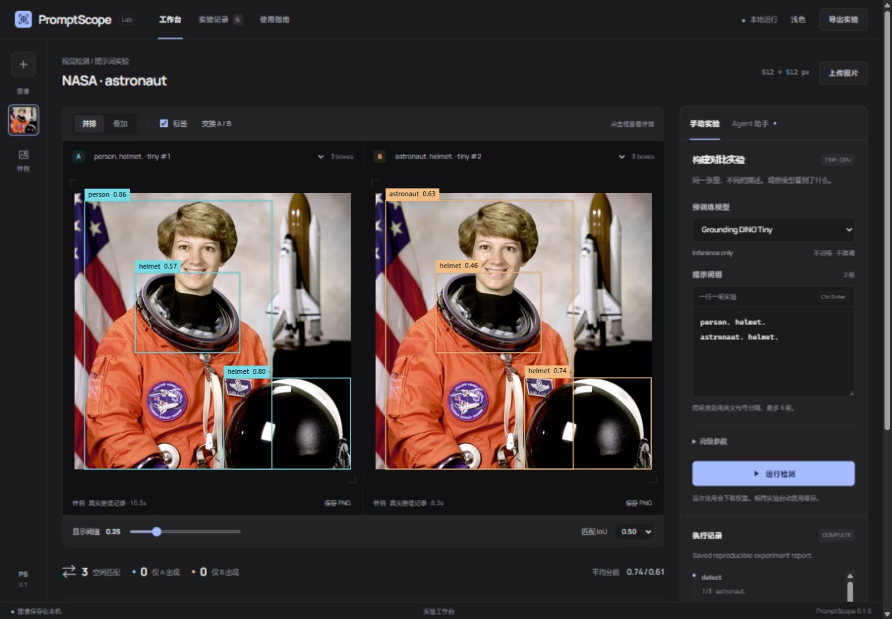

# PromptScope

**English** | [简体中文](README.zh-CN.md)

A local app for comparing how different prompts affect Grounding DINO detections. Uses pretrained Tiny / Base weights, with an optional LLM agent to suggest prompts and analyze results. No training required.



## Features

- Compare two detection results side by side or as an overlay; inspect boxes, scores and coordinates.
- Keep manual and Agent experiments in separate groups, with stars, deletion and restore.
- Ask the Agent to propose 2–4 prompts, review them, then run detection locally.
- Export JSON, CSV, Markdown or annotated PNG. Import detections or annotations for evaluation.

The NASA sample includes saved Tiny inference results and can be viewed without downloading weights.

## Setup

Requires Python 3.11 or 3.12. Run these commands from the project directory.

### Windows

```powershell
powershell -ExecutionPolicy Bypass -File .\scripts\Setup.ps1 -WithModel
.\.venv\Scripts\python.exe scripts\download_model.py --model tiny
.\.venv\Scripts\python.exe -m promptscope
```

Open http://127.0.0.1:8765. After setup, you can also launch the app with `Start-PromptScope.cmd`.

To browse saved results only, omit `-WithModel` and the download command.

### Linux / macOS

```bash
python3 -m venv .venv
source .venv/bin/activate
python -m pip install -r requirements.txt -r requirements-model.txt
python scripts/download_model.py --model tiny
python -m promptscope
```

Weights download from the official IDEA-Research repository to `models/`. Use `--model base` to download Base. Real inference has been tested on Windows CPU with Tiny; Base, CUDA and other operating systems remain unverified.

## Usage

1. Load the sample or upload an image.
2. Enter one prompt per line, such as `person. helmet.` and `astronaut. helmet.`.
3. Run detection, then choose two results as A and B to compare.

Each run creates a new experiment group. Identical detection requests reuse cached results. Records persist locally and can be reopened from the sidebar.

For Agent experiments, enter a target and research question, generate a plan, then review and execute it. Local template mode works without an API key.

## API connection

Click **API 接入** in the header. Choose DeepSeek, OpenAI or a custom Chat Completions compatible endpoint, enter your key and model, and set the thinking options. The endpoint must support JSON mode; thinking support depends on the model. Saved changes apply to new requests immediately.

Keys are stored on the local server and excluded from Git and exported reports. An empty key field keeps the saved key for the same provider and endpoint. The LLM receives text and structured detections; images stay local. API calls may incur provider charges.

See the [Chinese usage guide](docs/README.zh-CN.md) for environment variables and the DeepSeek launcher.

## Notes

- Model scores are not accuracy. Spatial matches describe box overlap, not whether a detection is correct.
- Evaluation requires annotations. Reported AP is for one image at one IoU threshold, not COCO mAP. Sample annotations are approximate.
- Data and weights are stored in `data/` and `models/`, both ignored by Git. The server listens on localhost only.

## Development

FastAPI backend; plain HTML, CSS and Canvas frontend. No frontend build step.

```bash
python -m unittest discover -s tests -v
node --check web/app.js
```

[Validation](docs/validation.md) · [Sample data](examples/README.md) · [Third-party licenses](docs/THIRD_PARTY.md) · [MIT license](LICENSE)
