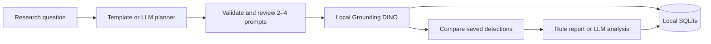

# PromptScope

**English** | [简体中文](README.zh-CN.md)

**One image. Different words. Inspect what changes.**

A local visual grounding workbench for exploring how natural-language prompts change a pretrained detector's outputs. Compare Grounding DINO experiments on a shared image, inspect spatial correspondences, and let a bounded agent plan and run prompt variants.

[中文使用说明](docs/README.zh-CN.md) · [Design system](docs/design-system.md) · [Validation](docs/validation.md) · [Third-party credits](docs/THIRD_PARTY.md)


## What it does

- **Visual evidence first.** Side-by-side and overlay views, cyan/amber annotations, clickable detections, score filtering, light and dark themes.
- **Pretrained inference.** Official Grounding DINO Tiny / Base snapshots with fixed revisions. No training, fine-tuning, or dataset preparation.
- **Bounded agent workflow.** Plan 2–4 prompt variants, inspect the plan, execute local detection, compare against the baseline, and produce an evidence-linked report.
- **Reproducible experiments.** Record prompts, model revisions, parameters, image fingerprints, runtimes and execution traces in local SQLite. Identical experiments reuse results.
- **Organized experiment history.** Each execution creates its own group. Separate manual/Agent tabs, stars, soft deletion and restore; A/B choices stay inside the selected group.
- **Portable outputs.** Export JSON, CSV, Markdown and annotated PNG. Import external detections or human annotations for single-image evaluation.

The bundled NASA example includes **actual recorded Tiny inference**, so you can inspect the editor before downloading model weights. Recorded examples, imported detections, and new inference have separate source labels. Failed inference never produces fabricated boxes.

## Run locally

Python **3.11 or 3.12**. No Node.js, frontend build, API key, or GPU is required to browse the bundled results.

### Windows

From the project directory:

```powershell
powershell -ExecutionPolicy Bypass -File .\scripts\Setup.ps1
.\.venv\Scripts\python.exe -m promptscope
```

Open **http://127.0.0.1:8765**. After setup, double-click `Start-PromptScope.cmd` to start the server. The script's execution-policy override applies to that process only.

For new local detections, install the CPU model dependencies:

```powershell
powershell -ExecutionPolicy Bypass -File .\scripts\Setup.ps1 -WithModel
.\.venv\Scripts\python.exe scripts\download_model.py --model tiny
```

Weights download from the official IDEA-Research Hugging Face repository to `models/`. The app also downloads missing files on first inference. Cached snapshots load locally without a network version check. Base is optional and downloads separately with `--model base`.

### Linux / macOS

```bash
python3 -m venv .venv
source .venv/bin/activate
python -m pip install -r requirements.txt
python -m promptscope
# Optional: new model inference
python -m pip install -r requirements-model.txt
python scripts/download_model.py --model tiny
```

The real-model validation was performed on Windows CPU; other operating systems and CUDA have not been validated with real weights. For CUDA, install the matching `torch` / `torchvision` builds using the [official PyTorch instructions](https://pytorch.org/get-started/locally/) before installing model requirements.

## Try an experiment

1. Load the NASA sample or upload a JPEG, PNG or WebP (up to 8 MiB / 24 megapixels).
2. Enter one prompt per line, e.g. `person. helmet.` and `astronaut. helmet.`.
3. Run detection, then choose A and B. Switch between side-by-side and overlay views.
4. Change the display threshold, click a box, or inspect the corresponding detection row.
5. Export the experiment. For annotation-based evaluation, select experiment A and import `examples/annotations.json` for the bundled sample.

The sample annotations are approximate teaching annotations, not a benchmark. See [examples](examples/README.md).

## Agent: plan → execute → observe



**Template mode** works without an API key. It generates a fixed set of linguistic variants and a deterministic report. It is explicitly labeled as a template, not an LLM.

**LLM mode** uses a Chat Completions compatible endpoint supporting JSON mode. Click **API 接入** in the header to choose DeepSeek, OpenAI or a custom compatible provider, fetch or enter a model ID, enter your key, and set thinking mode/effort. Saving applies to new requests immediately. A blank key retains the existing key only for the same provider and endpoint. DeepSeek uses `max_tokens`; other endpoints use `max_completion_tokens`. Thinking options depend on model support.

Settings are stored server-side in the ignored data directory as `llm-settings.json` and override environment defaults. Keys are excluded from settings responses and reports. Alternatively, set environment variables before starting the server:

```powershell
$env:PROMPTSCOPE_LLM_API_KEY = '<your-key>'
$env:PROMPTSCOPE_LLM_MODEL = '<your-model-id>'
$env:PROMPTSCOPE_LLM_BASE_URL = 'https://api.openai.com/v1'
.\.venv\Scripts\python.exe -m promptscope
```

The key stays on the server. The configured LLM receives the research question, target, prompts and structured detections; image bytes and filenames are not sent. Provider usage may incur charges. No key is bundled. A local DeepSeek Agent run has been verified; automated provider tests use mocks.

**DeepSeek quick setup (Windows):** copy `deepseek.example.json` to `deepseek.local.json` if the latter does not exist, fill only its empty `api_key`, then double-click `Start-DeepSeek.cmd`. The preconfigured endpoint is `https://api.deepseek.com`, model is `deepseek-flash`, and port is `8766`, following the [official API documentation](https://api-docs.deepseek.com/). Test records use `data/api-test/`; the key-containing local configuration is ignored by Git. Open http://127.0.0.1:8766 and select **LLM Agent**. See the [Chinese walkthrough](docs/README.zh-CN.md#deepseek-快速测试).

The agent has one fixed tool: local detection. It cannot run shell commands, install packages, train models, or choose arbitrary tools. There is one inference worker, at most three queued/running jobs, six prompts per manual job and four per agent plan. Cancellation takes effect between model calls; a running model call is allowed to finish.

## Interpret the numbers

| Output | Meaning |
| --- | --- |
| Model score | Phrase/region compatibility score; not calibrated correctness probability |
| Spatial match | Class-agnostic greedy, one-to-one IoU correspondence between A/B boxes |
| Only A / only B | Unmatched boxes at the current score and IoU thresholds; not automatically false positives or missed objects |
| P / R | Single-image precision/recall against supplied annotations at the display threshold |
| AP | Single-image all-points precision-envelope AP at one IoU threshold, using all saved candidates; **not COCO mAP** |

Native inference retains candidates above a 0.05 score floor. Filtering below that floor cannot recover discarded detections. Free-text labels require explicit mapping to ground-truth classes. Classes without ground truth have undefined AP and are excluded from its mean. More boxes or higher scores do not establish a better prompt.

## Configuration and storage

| Variable | Default / behavior |
| --- | --- |
| `PROMPTSCOPE_DEVICE` | CUDA when available, otherwise CPU; override with `cpu` or a valid Torch device |
| `PROMPTSCOPE_OFFLINE` | Set to `1` to reject downloads; requires cached model files |
| `PROMPTSCOPE_DATA_DIR` | `data/` in the project directory |
| `PROMPTSCOPE_LLM_*` | Optional LLM configuration above |

`python -m promptscope --port 8766` selects another port. The server binds to loopback only. It is a local personal tool, without multiuser authentication or a public hosting configuration.

Uploaded images are normalized to RGB PNG with EXIF orientation applied; metadata is stripped. `data/`, `models/`, `.venv/`, `.env` and development artifacts are excluded from Git. Keep source code and weights separate. Exported reports contain your prompts, image metadata and results; review them before sharing.

## Development

The frontend uses native HTML, CSS and Canvas with locally bundled fonts. FastAPI handles image storage, asynchronous jobs, inference, analysis and agent orchestration.

```bash
python -m pip install -r requirements.txt
python -m unittest discover -s tests -v
node --check web/app.js
```

Unit/API tests use a detector fixture and do not download weights. To reproduce the real model example after installing model dependencies, run `python scripts/smoke_model.py`; this rewrites `examples/sample-runs.json` with genuine outputs.

Source code: MIT. Model and asset licenses are documented in [third-party credits](docs/THIRD_PARTY.md). Built as an electronic information engineering / computer vision portfolio project.
