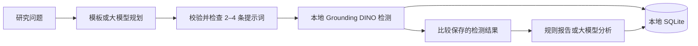

# PromptScope

[English](README.md) | **简体中文**

**同一张图片，不同的描述，看看检测结果如何变化。**

PromptScope 是一个运行在本机的二维视觉定位实验台，用于研究自然语言提示词如何影响预训练检测模型的输出。你可以在同一张图片上对比 Grounding DINO 的检测结果、检查检测框之间的空间对应关系，也可以让 Agent 规划提示词变体、调用本地检测工具并分析结果。

[详细使用说明](docs/README.zh-CN.md) · [界面设计规范（英文）](docs/design-system.md) · [验证记录（英文）](docs/validation.md) · [第三方来源与许可（英文）](docs/THIRD_PARTY.md)


## 项目功能

- **直观比较检测结果。** 支持并排与叠加视图、青色 / 琥珀色标注、点击检测框查看详情、分数筛选，以及深浅两种主题。
- **直接使用预训练权重。** 使用固定版本的官方 Grounding DINO Tiny / Base 模型，无需训练、微调或准备训练数据集。
- **有明确边界的 Agent 流程。** 规划 2–4 条提示词，人工检查计划后执行本地检测，与基线比较并生成基于检测结果的报告。
- **可复现的实验记录。** 本地 SQLite 保存提示词、模型版本、参数、图片指纹、耗时和执行轨迹；相同条件的检测会复用缓存。
- **独立管理实验组。** 每次执行都会新增一组实验，手动实验与 Agent 实验分开显示，支持星标保留、删除及恢复。A/B 选择仅限当前组内的结果。
- **导出与评估。** 支持 JSON、CSV、Markdown 和带框 PNG；可导入外部检测结果或人工标注，进行单张图片的评估。

内置 NASA 宇航员样例包含 **Tiny 模型的真实推理记录**，未下载权重也能先浏览工作台。样例记录、外部导入和本机新推理分别标注来源；推理失败时不会生成虚假的检测框。

## 本机运行

需要 Python **3.11 或 3.12**。浏览内置结果不需要 Node.js、前端构建、API Key 或 GPU。

### Windows

在项目目录打开 PowerShell，执行：

```powershell
powershell -ExecutionPolicy Bypass -File .\scripts\Setup.ps1
.\.venv\Scripts\python.exe -m promptscope
```

打开 **http://127.0.0.1:8765**。安装完成后也可以双击 `Start-PromptScope.cmd` 启动。脚本中的执行策略设置只对当前进程生效。

如需运行新的本地检测，安装 CPU 模型依赖并下载权重：

```powershell
powershell -ExecutionPolicy Bypass -File .\scripts\Setup.ps1 -WithModel
.\.venv\Scripts\python.exe scripts\download_model.py --model tiny
```

权重从 IDEA-Research 官方 Hugging Face 仓库下载至 `models/`。首次推理也会下载缺少的模型文件；已有完整缓存时直接从本地加载，不再联网检查版本。Base 为可选模型，使用 `--model base` 单独下载。

### Linux / macOS

```bash
python3 -m venv .venv
source .venv/bin/activate
python -m pip install -r requirements.txt
python -m promptscope
```

如需新的模型推理，在同一个虚拟环境中安装模型依赖：

```bash
python -m pip install -r requirements-model.txt
python scripts/download_model.py --model tiny
```

真实模型验证在 Windows CPU 上完成；其他操作系统和 CUDA 尚未使用真实权重验证。使用 CUDA 时，请先按照 [PyTorch 官方说明](https://pytorch.org/get-started/locally/) 安装匹配的 `torch` / `torchvision`，再安装模型依赖。

## 开始一次实验

1. 加载 NASA 样例，或上传 JPEG、PNG、WebP 图片，最大 8 MiB / 2400 万像素。
2. 在「手动实验」中每行填写一条提示词，例如 `person. helmet.` 和 `astronaut. helmet.`。
3. 点击「运行检测」，在当前实验组中选择 A 与 B，使用「并排」或「叠加」查看差异。
4. 调整显示阈值，点击检测框或对应的检测明细，检查标签、分数与坐标。
5. 导出实验。如果需要基于人工标注评估，先选好 A；对于内置样例，可以导入 `examples/annotations.json`。

每次运行都会新增一个实验组，即使使用同一图片或命中缓存。左侧「手动 / Agent」分别管理两类实验，点击卡片可恢复该组内容；星标保留用于置顶，删除后可在回收站恢复。

样例中的人工标注是近似的教学标注，不是正式基准数据。参见 [样例说明（英文）](examples/README.md)。

## Agent：规划 → 执行 → 观察



**本地模板模式**无需 API Key，使用固定的语言变体和确定性报告，并明确标注为模板。

**LLM 模式**需要支持 JSON mode 的 Chat Completions 兼容接口。点击页面顶部的 **「API 接入」**：

1. 选择 DeepSeek、OpenAI 或自定义兼容服务；自定义服务可填写名称和接口基础地址。
2. 填写 API Key。若当前接口显示「已配置」，留空会保留已有密钥；切换运营商或接口地址后不会沿用旧密钥。
3. 获取模型列表并选择模型，也可以直接填写模型 ID。
4. 选择跟随模型默认、关闭思考或开启思考；开启后再选择思考强度。具体支持范围取决于所选模型。
5. 点击「保存并应用」，新请求立即使用新配置，无需重启，然后在 Agent 面板选择「LLM Agent」。

DeepSeek 请求使用 `max_tokens`，其他兼容接口使用 `max_completion_tokens`。配置保存在当前数据目录的 `llm-settings.json`，优先于环境变量，不进入 Git。设置接口不会回传已保存的密钥，导出报告也不包含密钥。

也可以在启动服务前设置环境变量作为初始配置：

```powershell
$env:PROMPTSCOPE_LLM_API_KEY = '<你的密钥>'
$env:PROMPTSCOPE_LLM_MODEL = '<服务商的模型 ID>'
$env:PROMPTSCOPE_LLM_BASE_URL = 'https://api.openai.com/v1'
.\.venv\Scripts\python.exe -m promptscope
```

密钥由本机服务端使用。大模型只接收研究问题、目标概念、提示词和结构化检测结果，不接收图片文件或文件名。调用费用以服务商规则为准。项目不附带密钥；已在本机完成一次 DeepSeek Agent 流程，自动化服务商测试使用模拟响应。

**DeepSeek 快速启动（Windows）：** 如果没有 `deepseek.local.json`，复制 `deepseek.example.json` 并改名，只填写其中空白的 `api_key`，然后双击 `Start-DeepSeek.cmd`。预设地址为 `https://api.deepseek.com`，模型为 `deepseek-flash`，端口为 `8766`；配置依据见 [DeepSeek 官方文档](https://api-docs.deepseek.com/)。该启动器将记录单独保存在 `data/api-test/`，含密钥的本地配置已被 Git 忽略。打开 http://127.0.0.1:8766 后选择「LLM Agent」。详见 [中文测试步骤](docs/README.zh-CN.md#deepseek-快速测试)。

Agent 只有本地检测这一项固定工具，不能执行命令、安装软件、训练模型或选择任意工具。系统只有一个推理工作线程，最多同时保留三个排队或运行中的任务；每次手动实验最多六条提示词，每个 Agent 计划最多四条。取消操作在模型调用之间生效，正在进行的调用会先完成。

## 如何理解指标

| 输出 | 含义 |
| --- | --- |
| 模型分数 | 提示词与区域的兼容性分数，不是经过校准的正确概率 |
| 空间匹配 | 不区分类别，使用贪心算法建立 A/B 检测框之间一对一的 IoU 对应关系 |
| 仅 A / 仅 B | 当前分数和 IoU 阈值下未匹配的框，不能直接判定为误检或漏检 |
| P / R | 在显示阈值下，相对于所提供人工标注的单图精确率 / 召回率 |
| AP | 使用所有保存候选框，在单张图片、单个 IoU 阈值下计算的精确率包络 all-points AP，**不是 COCO mAP** |

本机推理保留分数高于 0.05 的候选框，把显示阈值调得更低也无法恢复已丢弃的框。自由文本标签需要显式映射到人工标注类别；没有真实标注实例的类别，其 AP 未定义，不参与平均值计算。检测框更多或模型分数更高，都不能单独证明提示词更好。

## 配置与数据存储

| 环境变量 | 默认值 / 行为 |
| --- | --- |
| `PROMPTSCOPE_DEVICE` | CUDA 可用时使用 CUDA，否则使用 CPU；可指定 `cpu` 或有效的 Torch 设备 |
| `PROMPTSCOPE_OFFLINE` | 设为 `1` 时禁止下载，需要提前准备完整的模型缓存 |
| `PROMPTSCOPE_DATA_DIR` | 默认使用项目目录下的 `data/` |
| `PROMPTSCOPE_LLM_*` | 可选的大模型初始配置，见上文 |

使用 `python -m promptscope --port 8766` 可更换端口。服务只监听本机回环地址，面向个人本地使用，尚未提供多用户认证或公网部署配置。

上传图片会应用 EXIF 方向信息并统一转换为 RGB PNG，原始元数据会被移除。`data/`、`models/`、`.venv/`、`.env`、本地 API 配置和开发产物均被 Git 忽略。源码与权重分开管理；导出的报告包含提示词、图片元信息和检测结果，分享前请检查内容。

## 开发与验证

前端使用原生 HTML、CSS、Canvas 和本地字体，无需前端构建。FastAPI 负责图片存储、异步任务、推理、分析和 Agent 调度。

```bash
python -m pip install -r requirements.txt
python -m unittest discover -s tests -v
node --check web/app.js
```

单元测试和 API 测试使用测试检测器，不下载权重。安装模型依赖后，可以运行 `python scripts/smoke_model.py` 复现真实模型样例；该脚本会用真实输出重新写入 `examples/sample-runs.json`。验证范围与限制见 [验证记录（英文）](docs/validation.md)。

源码使用 [MIT 许可证](LICENSE)。模型和素材的许可见 [第三方来源与许可（英文）](docs/THIRD_PARTY.md)。本项目面向电子信息工程与计算机视觉方向的学习、实验和作品展示。
