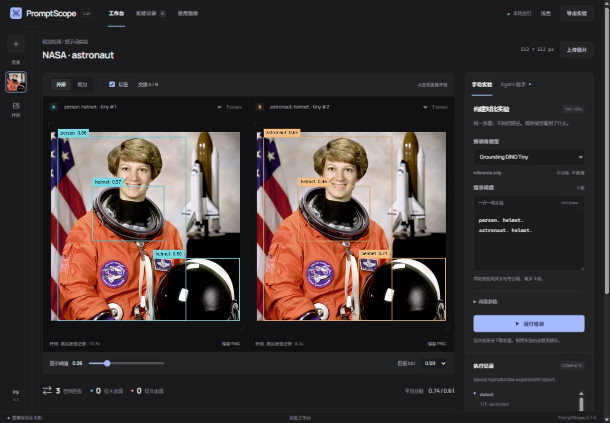

# PromptScope

[English](README.md) | **简体中文**

一个本地目标检测对比工具，用来观察不同提示词对 Grounding DINO 检测结果的影响。直接使用 Tiny / Base 预训练权重，无需训练；也可以接入大模型，让 Agent 生成提示词并分析结果。



## 功能

- 并排或叠加比较两次检测结果，查看检测框、分数和坐标。
- 手动实验与 Agent 实验分组保存，支持星标、删除和恢复。
- Agent 每次生成 2–4 条提示词，检查计划后调用本地模型检测。
- 导出 JSON、CSV、Markdown 和带框 PNG，也可导入检测结果或人工标注。

内置 NASA 宇航员图片和 Tiny 推理记录，未下载权重也能先查看样例。

## 安装运行

需要 Python 3.11 或 3.12，在项目目录执行以下命令。

### Windows

```powershell
powershell -ExecutionPolicy Bypass -File .\scripts\Setup.ps1 -WithModel
.\.venv\Scripts\python.exe scripts\download_model.py --model tiny
.\.venv\Scripts\python.exe -m promptscope
```

打开 http://127.0.0.1:8765。安装完成后，也可以双击 `Start-PromptScope.cmd` 启动。

只看已有结果时，可以省略 `-WithModel` 和下载权重的命令。

### Linux / macOS

```bash
python3 -m venv .venv
source .venv/bin/activate
python -m pip install -r requirements.txt -r requirements-model.txt
python scripts/download_model.py --model tiny
python -m promptscope
```

权重从 IDEA-Research 官方仓库下载到 `models/`，使用 `--model base` 可下载 Base。目前已验证 Windows CPU 上的 Tiny 推理，Base、CUDA 和其他系统尚未验证。

## 使用

1. 加载样例或上传图片。
2. 每行填写一条提示词，例如 `person. helmet.` 和 `astronaut. helmet.`。
3. 点击运行，再选择两条结果作为 A、B 进行对比。

每次运行会新建一个实验组，相同条件的检测会复用缓存。记录保存在本机，可从侧栏重新打开。

使用 Agent 时，填写目标概念和研究问题，生成计划后检查并执行。本地模板模式不需要 API Key。

## API 接入

点击顶部「API 接入」，选择 DeepSeek、OpenAI 或自定义 Chat Completions 兼容服务，填写密钥和模型，设置思考模式。接口需要支持 JSON mode，思考选项以模型支持范围为准。保存后对新请求立即生效。

密钥保存在本机服务端，不进入 Git 或导出报告。同一运营商、同一接口下，密钥框留空会保留原配置。大模型只接收文本和结构化检测结果，图片留在本地。API 调用按服务商规则计费。

环境变量配置和 DeepSeek 启动器的用法见 [详细使用说明](docs/README.zh-CN.md)。

## 说明

- 模型分数不等于准确率，空间匹配只表示检测框的重叠关系。
- 评估需要人工标注。这里的 AP 是单张图片、单个 IoU 阈值下的结果，不是 COCO mAP；样例标注仅供演示。
- 实验数据和权重分别存放在 `data/`、`models/`，均已加入 Git 忽略规则。服务只监听本机地址。

## 开发

后端使用 FastAPI，前端使用原生 HTML、CSS 和 Canvas，无需前端构建。

```bash
python -m unittest discover -s tests -v
node --check web/app.js
```

[验证记录](docs/validation.md) · [样例说明](examples/README.md) · [第三方许可](docs/THIRD_PARTY.md) · [MIT 许可证](LICENSE)
